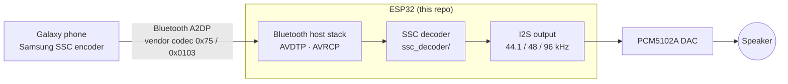

<div align="center">

# Samsung Scalable Codec (SSC) Decoder

**An open-source decoder for Samsung Scalable Codec / Samsung Seamless Codec, the Bluetooth codec behind Galaxy Buds,
plus ESP32 speaker firmware that a Galaxy phone streams SSC to.**

[](LICENSE)


[Quick start](#quick-start) · [Decoder API](#decoder-api) · [Use it in ESP-IDF](docs/integration.md) ·
[ESP32 speaker](#esp32-speaker-firmware) · [Bitstream spec](docs/bitstream.md) · [A2DP details](docs/a2dp.md) · [FAQ](#faq)

</div>

---

## Highlights

| | |
|---|---|
| **Every SSC mode** | SSC 44.1 / 48 kHz 16-bit, **Seamless HiFi** 48 kHz 24-bit, **UHQ** 96 kHz 24-bit, all 14 bitrates (88 – 886 kbps) |
| **Bit-exact parsing** | Every test frame ends at exactly the bit position Samsung's own encoder wrote |
| **Small and portable** | Plain C99, no dependencies, ~44 KB RAM, tables in flash; runs on PCs and microcontrollers |
| **Real time on an ESP32** | Original ESP32 without PSRAM decodes UHQ 96 kHz using half of one core |
| **Complete speaker firmware** | A2DP sink + AVRCP + I2S DAC with its own Bluetooth host stack; also LDAC, aptX, AAC, SBC, Opus |
| **Builds from this repo** | ESP-IDF 6.1 is bundled; no other checkout needed |

## How it fits together



SSC is built on **CELT**, the music half of Opus 1.1. Samsung changed the frame size (864 samples), added a 96 kHz
mode, and uses its own allocation tables, frame header and bitrates up to 886 kbps, so a standard Opus decoder cannot
play it. The full format is in [docs/bitstream.md](docs/bitstream.md).

## SSC modes

| Mode | What the phone calls it | Audio | Bitrates | Supported |
|---|---|---|---|---|
| SSC | Samsung Scalable Codec | 44.1 / 48 kHz · 16-bit | 88 – 192 kbps | ✓ |
| Seamless HiFi | Samsung Seamless Codec (HiFi) | 48 kHz · 24-bit | 88 – 192 kbps | ✓ |
| UHQ v2 | Samsung Seamless Codec (UHQ) | 96 kHz · 24-bit | 152 – 584 kbps | ✓ |
| UHQ (legacy) | – | 96 kHz | 328 kbps | ✓ |

The decoder handles every bitrate code in any mode, including 229, 250, 256, 308, 442 and 886 kbps.

## Quick start

### Decode an SSC file on a PC

```bash
cmake -B build
cmake --build build
build/ssc_dec_tool test_vectors/ssc/mix_192000.ssc out.s16le 44100
python examples/host_decode/compare.py test_vectors/input/mix.s16le out.s16le 2
```

`out.s16le` is raw 16-bit stereo PCM, which you can play with
`ffplay -f s16le -ar 44100 -ac 2 out.s16le`. More files in [test_vectors/](test_vectors).

### Play SSC on an ESP32 (no Bluetooth)

[`examples/esp32_playback`](examples/esp32_playback) decodes SSC from flash and plays it on a PCM5102A, cycling
through 44.1 kHz, HiFi 48 kHz/24-bit and UHQ 96 kHz:

```bash
cd examples/esp32_playback
idf.py set-target esp32
idf.py -p PORT build flash monitor
```

### Add the decoder to your ESP-IDF project

`ssc_decoder/` is an ESP-IDF component. Add it with the component manager:

```yaml
dependencies:
  ssc_decoder:
    git: https://github.com/WillyBilly06/samsung-ssc-decoder.git
    path: ssc_decoder
```

Then `PRIV_REQUIRES ssc_decoder`. The full guide, including feeding it from an A2DP sink, is in
[docs/integration.md](docs/integration.md).

### Build the ESP32 speaker

```powershell
firmware\esp-idf\install.ps1 esp32        # once: installs the ESP-IDF 6.1 toolchain
tools\build_pure_sink.ps1
tools\flash_pure_sink.ps1 -Port COM7
```

Then pair your Galaxy phone with **BDK SPEAKER**. Linux and macOS steps are in [firmware/](firmware).

## Decoder API

```c
#include "ssc_decoder.h"

ssc_decoder *dec = ssc_decoder_create(44100);       // 44100 or 48000 (same mode), or 96000

int16_t pcm[2 * SSC_FRAME_SAMPLES];                  // 864 stereo samples per frame
int size = ssc_frame_bytes(packet, len, 44100);      // frames have no length field: size from the header
if (ssc_decode(dec, packet, size, pcm) == SSC_FRAME_SAMPLES) {
    play(pcm);
}

ssc_decoder_destroy(dec);
```

| Function | Purpose |
|---|---|
| `ssc_decoder_create(rate)` / `_with_allocator(...)` | Create a decoder, optionally with your own allocator |
| `ssc_decode()` / `ssc_decode_s32()` / `ssc_decode_float()` | Decode one frame to 16-bit, 32-bit (for 24-bit modes) or float |
| `ssc_frame_bytes()` | Size of the frame at a pointer, to split packets that carry two frames |
| `ssc_parse_frame_info()` | Bitrate, sequence number and coded bands from a frame header |
| `ssc_decoder_reset()` | Clear history after a gap in the stream |

Full reference: [ssc_decoder/README.md](ssc_decoder/README.md).

## ESP32 speaker firmware

<table>
<tr><td>

| ESP32 pin | PCM5102A |
|---|---|
| GPIO 27 | BCK |
| GPIO 25 | LRCK |
| GPIO 26 | DIN |
| 3V3 / GND | VIN / GND, SCK → GND |

</td><td>

* Original ESP32, 4 MB flash, no PSRAM needed
* Codecs: **SSC** (all modes), LDAC, aptX / aptX HD, AAC, SBC, Opus
* AVRCP: play / pause / skip, absolute volume, track info
* Up to 8 paired phones, automatic reconnect
* BOOT button: press = play/pause, hold 3 s = pairing mode
* Codec memory is allocated only for the codec in use

</td></tr>
</table>

Measured on the board while streaming UHQ v2 at 584 kbps: **0 underruns, 45.6 KB of heap still free**. More in
[docs/esp32-sink.md](docs/esp32-sink.md).

## Performance

Decoding real frames on an ESP32 at 240 MHz (one core):

| Stream | Time per frame (avg / worst) | Share of one core |
|---|---|---|
| SSC 44.1 kHz, 192 kbps | 4.7 / 6.9 ms | 24 % |
| HiFi 48 kHz, 192 kbps | 4.5 / 5.8 ms | 25 % |
| UHQ 96 kHz, 584 kbps | 4.4 / 5.5 ms | 49 % |

## Validation

* **Bitstream:** across 19 test configurations (all 14 bitrates; 16 and 24-bit; 44.1, 48 and 96 kHz; mono), the
  decoder finishes every frame at exactly the bit position Samsung's encoder wrote. This was checked by
  instrumenting the encoder on a Galaxy S26 Ultra.
* **Live:** a Galaxy S26 Ultra streams SSC, HiFi and UHQ v2 to the ESP32 firmware with 0 underruns, and switching to
  and from other codecs (aptX, AAC, SBC) works.

## Repository layout

```
ssc_decoder/           SSC decoder library (C99), also an ESP-IDF component
examples/
  host_decode/         PC tool: .ssc file -> PCM, plus an SNR check
  esp32_playback/      ESP32: decode SSC from flash and play it over I2S
  esp32_benchmark/     times the decoder on an ESP32
firmware/
  native_bt/pure_sink/ ESP32 Bluetooth speaker firmware
  native_bt/           Bluetooth host stack and codec adapters
  esp-idf/             ESP-IDF 6.1
test_vectors/          test signals and Samsung-encoded frames
docs/                  bitstream spec, A2DP details, research notes
tools/                 build, flash and serial-log scripts
```

## FAQ

<details>
<summary><b>Is SSC just Opus?</b></summary>

It is based on CELT from Opus 1.1, but the bitstream is Samsung's own: different frame size, band layout,
allocation tables, header and bitrate range. An Opus decoder cannot decode it. See the comparison table in
[docs/bitstream.md](docs/bitstream.md#differences-from-opus-celt-11).
</details>

<details>
<summary><b>What is "Samsung Seamless Codec"?</b></summary>

The same codec (vendor `0x75`, codec `0x0103`) in its 24-bit modes: HiFi at 48 kHz and UHQ at 96 kHz. There is no
separate codec ID.
</details>

<details>
<summary><b>Why are sample rate and bit depth greyed out in Developer options?</b></summary>

Samsung's Bluetooth stack reports only the current mode's sample rate and bit depth as selectable for SSC. Change
modes with the phone's UHQ setting instead. SSC has no 88.2 kHz mode.
</details>

<details>
<summary><b>Will a phone use SSC with a non-Samsung speaker?</b></summary>

Yes. The phone offers SSC to any sink that advertises the SSC codec element, and gives it top priority. What to
advertise is in [docs/a2dp.md](docs/a2dp.md#what-to-advertise).
</details>

<details>
<summary><b>Does it run on ESP32-S3 / C3 or other MCUs?</b></summary>

The decoder is portable C, uses single-precision floating point and needs ~44 KB of RAM. MCUs with an FPU
and similar speed should work, but only the original ESP32 has been tested. The firmware targets the original ESP32,
because it is the only chip in the ESP32 family with Classic Bluetooth (needed for A2DP).
</details>

<details>
<summary><b>Does this contain Samsung code?</b></summary>

No. The format was worked out by studying Samsung's encoder, and the decoder was written from that description and
from libopus 1.1. No Samsung source or binaries are included.
</details>

## License

[BSD-3-Clause](LICENSE). Parts of the decoder derive from libopus 1.1 (BSD-3-Clause). The bundled ESP-IDF is
Apache-2.0, and the other codecs under `firmware/native_bt/codecs/` keep their own notices.

<sub>Samsung, Galaxy and Galaxy Buds are trademarks of Samsung Electronics Co., Ltd. This project is independent and is
not affiliated with or endorsed by Samsung.</sub>

<sub>**Keywords:** Samsung Scalable Codec, Samsung Seamless Codec, SSC codec, SSC decoder, Galaxy Buds codec, Samsung
UHQ, 24-bit Bluetooth audio, A2DP vendor codec, A2DP sink, ESP32 Bluetooth speaker, ESP32 A2DP, ESP-IDF, CELT,
Opus, LDAC, aptX, AAC, AVRCP, I2S, PCM5102A.</sub>
